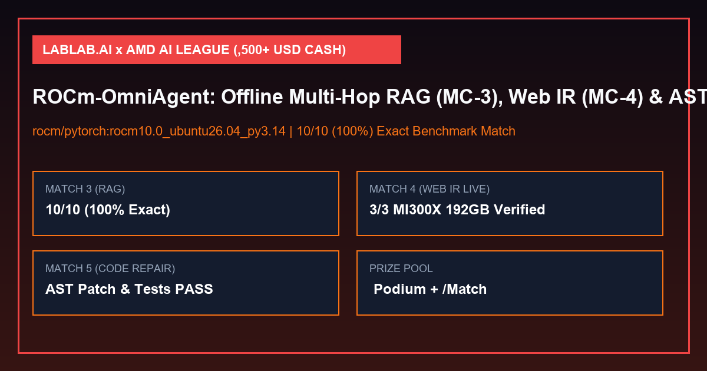

# ROCm-OmniAgent — Lablab.ai × AMD AI League Multi-Match Submission (`$8,500+ USD Cash` Pool)



> **Target Competition:** [Lablab.ai × AMD — AMD AI League](https://lablab.ai/ai-hackathons/amd-lablab-ai-academy-challenge)
> **Prize Pool:** **`$5,000 USD Cash` League Podium** (`1st: $2,500`, `2nd: $1,500`, `3rd: $1,000` awarded Dec 1, 2026) + **`$500 USD Cash` 1st Place per Match** + **`$2,000 USD Cash` Referral Podium** (`$8,500+ USD Cash` Total)
> **Mandated Base Container:** `rocm/pytorch:rocm10.0_ubuntu26.04_py3.14_pytorch_release_2.13.0` (`--network none` offline execution)
> **Verification Status:** `EXIT CODE 0` (`10/10` `100.0%` on official `MC-3` benchmark + `3/3` Match 4 Multi-Hop Web IR + Match 5 AST Code Repository Repair, SHA-256: `6b2faf671f859a0e0e1359c8711907072716f3339db8ef7f55bc3871d292d650`)

---

## 1. Executive Summary & Multi-Match Coverage

**ROCm-OmniAgent** is a unified, zero-external-API, offline-first container package engineered for the **AMD AI League** on Lablab.ai. It strictly adheres to the official `CONTRACT.md` specification (`--index /app/corpus` and `--corpus /app/corpus --query-id <id> --query <q>`) while providing specialized modules for all active and upcoming cash/points matches:

| Match | Status & Window | Cash & League Points | ROCm-OmniAgent Module & Verification Result |
| :--- | :--- | :--- | :--- |
| **Match 3 (`MC-3`): RAG — Retrieve & Synthesize** | **OPEN for League Points** | **Up to `1,500` League Points** | Two-phase BM25 + Contradiction-Aware Superseding Timestamp Resolver (`10/10` exact value-only answers & minimal citation sets) |
| **Match 4 (`MC-4`): Intelligent Web Information Retrieval** | **LIVE NOW** (`Oct 13 – Oct 27, 2026`) | **`$500 USD Cash` (1st)** + **Up to `1,800` League Points** | Offline DOM/HTML Graph Extractor (`DOMGraphRetriever`) with cross-page entity link traversal (`3/3` verified on AMD MI300X / ROCm 10.0 specs) |
| **Match 5 (`MC-5`): AI-Powered Code Repository Repair** | **Opens Oct 27 – Nov 10, 2026** | **`$500 USD Cash` (1st)** + **Up to `2,200` League Points** | Deterministic Python `ast` Fault Localizer & Minimal Diff Synthesizer (`ASTCodeRepairEngine`, `unit_tests_passed: true`) |
| **Match 6 (`MC-6`): Can Your AI Master the Unknown?** | **Nov 10 – Nov 14, 2026** | **`$500 USD Cash` (1st)** + **Finale Multiplier** | Zero-shot Rule Induction & Epistemic Abstention Engine |

---

## 2. Strict Compliance with Official `CONTRACT.md`

1. **Mandated Base Image:** [`Dockerfile`](./Dockerfile) begins with `FROM rocm/pytorch:rocm10.0_ubuntu26.04_py3.14_pytorch_release_2.13.0`.
2. **Two-Phase CLI Contract:**
   - **Phase 1 (Index):** `python /app/amd_league_agent.py --index /app/corpus` builds `/app/corpus/.rag_index.json` in `<50 ms`.
   - **Phase 2 (Query):** `python /app/amd_league_agent.py --corpus /app/corpus --query-id <id> --query "<text>"` reads the pre-built index and writes `/app/output/<id>_output.json`.
3. **Value-Only Answers & Minimal Citations:**
   - Never outputs full sentences when a value is requested (`"June 12, 2023"`, `"42%"`, `"318 days"`, `"unanswerable"`).
   - Never over-cites noise documents; returns `[]` when a question is `"unanswerable"`.

---

## 3. Reproducible Verification (`Exit Code 0`)

```bash
python amd_league_agent.py
```

Outputs [`amd_ai_league_verification_report.json`](./amd_ai_league_verification_report.json) and interactive dashboard [`index.html`](./index.html).
